# Guía del Transformer para clasificación de género musical (AST)

Guía de estudio y de construcción desde cero del modelo de este repositorio: un **Audio Spectrogram Transformer (AST)** que clasifica clips de 10 s de FMA en 8 géneros a partir de su log-mel espectrograma.

- Las fórmulas están en LaTeX (se ven en GitHub, VS Code con extensión Markdown+Math, Typora…).
- Las figuras están en `docs/figures/` y se regeneran con `python docs/make_figures.py`.
- `docs/transformer_numpy.py` implementa **forward y backward a mano** de un bloque Transformer completo en numpy y lo verifica contra diferencias finitas (error relativo ≈ 1e-9). Es la mejor forma de comprobar que entiendes las derivadas.
- Los números concretos (dimensiones, parámetros) salen de `configs/` y `models/ast_scratch.py`.

**Índice**

0. [Mapa mental](#0-mapa-mental)
1. [Del audio al tensor de entrada](#1-del-audio-al-tensor-de-entrada)
2. [Embedding de parches](#2-embedding-de-parches)
3. [Codificación posicional y token [CLS]](#3-codificación-posicional-y-token-cls)
4. [Auto-atención: el núcleo matemático](#4-auto-atención-el-núcleo-matemático)
5. [Multi-head attention](#5-multi-head-attention)
6. [El bloque encoder: LayerNorm, MLP, residuales](#6-el-bloque-encoder-layernorm-mlp-residuales)
7. [Cabeza de clasificación y función de pérdida](#7-cabeza-de-clasificación-y-función-de-pérdida)
8. [Retropropagación a través del Transformer](#8-retropropagación-a-través-del-transformer)
9. [Optimización: AdamW, warm-up, coseno](#9-optimización-adamw-warm-up-coseno)
10. [Regularización y aumento de datos](#10-regularización-y-aumento-de-datos)
11. [Complejidad, parámetros y memoria](#11-complejidad-parámetros-y-memoria)
12. [Guía de construcción desde cero (paso a paso)](#12-guía-de-construcción-desde-cero-paso-a-paso)
13. [Entrenamiento y evaluación](#13-entrenamiento-y-evaluación)
14. [Diagnóstico de problemas típicos](#14-diagnóstico-de-problemas-típicos)
15. [Plan de estudio y ejercicios](#15-plan-de-estudio-y-ejercicios)
16. [Referencias](#16-referencias)

---

## 0. Mapa mental

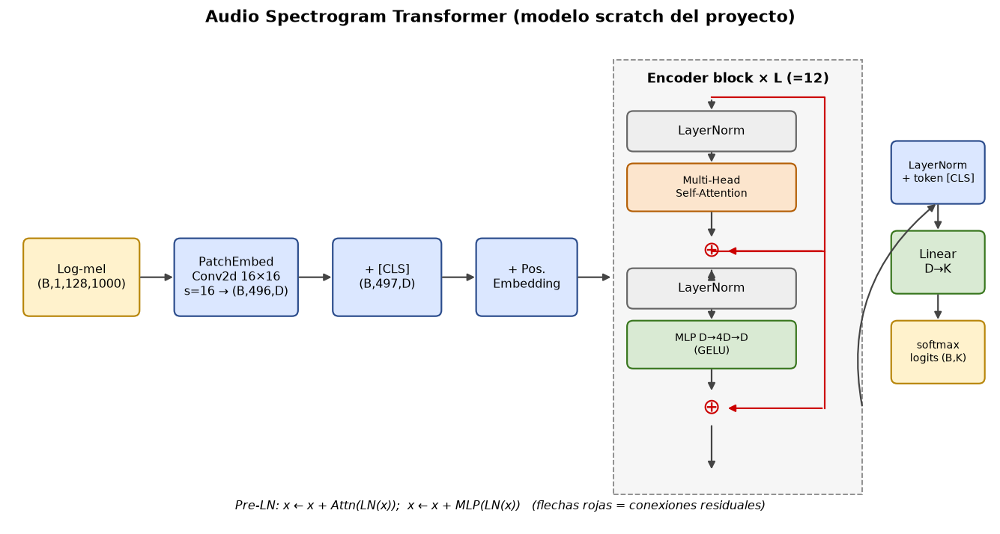

Flujo completo (con las formas de tensor reales del proyecto, $B$ = batch):

| Etapa | Operación | Forma |
|---|---|---|
| Audio | mono, 16 kHz, recorte aleatorio de 10 s | $(B, 160000)$ |
| Log-mel | STFT → filtros mel → dB | $(B, 1, 128, \approx 1000)$ |
| Parches | `Conv2d(1, D, k=16, s=16)` | $(B, D, 8, 62)$ |
| Tokens | aplanar + transponer | $(B, 496, D)$ |
| + [CLS] + pos | concatenar y sumar | $(B, 497, D)$ |
| Encoder ×12 | atención + MLP (pre-LN, residuales) | $(B, 497, D)$ |
| Pooling | token [CLS] tras LayerNorm | $(B, D)$ |
| Cabeza | `Linear(D, 8)` | $(B, 8)$ logits |

con $D = 256$, 12 bloques, 8 cabezas (`configs/model/ast_scratch.yaml`).

La idea central: **tratar el espectrograma como una imagen**, trocearlo en parches, convertir cada parche en un vector (token) y dejar que la auto-atención decida qué partes del espectro/tiempo se relacionan para decidir el género.

---

## 1. Del audio al tensor de entrada

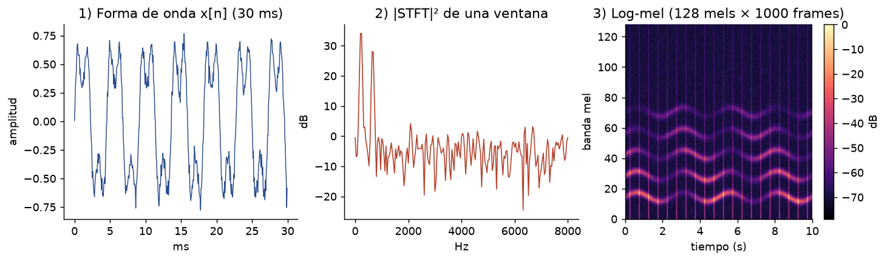

### 1.1 Muestreo y ventaneo

Una señal continua $x(t)$ se muestrea a $f_s = 16\,000$ Hz: $x[n] = x(n/f_s)$. Por Nyquist, solo se representan frecuencias $\le f_s/2 = 8$ kHz (de ahí `f_max: 8000`).

### 1.2 STFT

Se divide la señal en ventanas de $N = 400$ muestras (25 ms, `n_fft`) con salto $H = 160$ (10 ms, `hop_length`) y se aplica una ventana $w[n]$ (Hann) y la DFT:

$$
X[m, k] = \sum_{n=0}^{N-1} x[n + mH]\, w[n]\, e^{-j 2\pi k n / N}, \qquad k = 0,\dots,N/2
$$

El espectrograma de potencia es $P[m,k] = |X[m,k]|^2$ ($m$ = frame, $k$ = bin; resolución $f_s/N = 40$ Hz). Para 10 s hay $\lfloor 160000/160 \rfloor + 1 = 1001$ frames (con padding centrado).

### 1.3 Banco de filtros mel

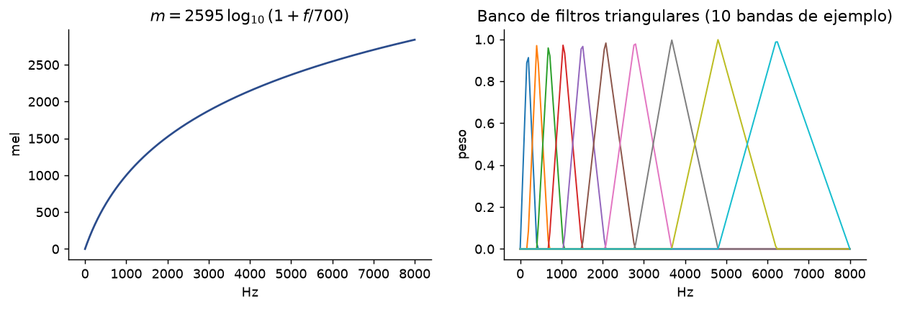

El oído percibe el tono de forma ~logarítmica. La escala mel:

$$
m(f) = 2595\,\log_{10}\!\left(1 + \frac{f}{700}\right), \qquad f(m) = 700\,\left(10^{m/2595} - 1\right)
$$

Se colocan $M = 128$ filtros triangulares equiespaciados en mel entre 0 y 8000 Hz. Cada banda es una combinación lineal de bins: $S[m, i] = \sum_k H_i[k]\,P[m,k]$, con $H \in \mathbb{R}^{128 \times 201}$.

### 1.4 Escala logarítmica (dB) y normalización

$$
L[m,i] = 10\,\log_{10}\!\big(\max(S[m,i], \epsilon)\big), \qquad L \leftarrow \max(L,\; L_{\max} - 80\text{ dB})
$$

(`top_db: 80`). La compresión logarítmica imita la percepción de sonoridad y estabiliza el rango dinámico. Después se normaliza con media y desviación **globales del conjunto de entrenamiento**: $\tilde L = (L - \mu)/\sigma$ (`data/stats.py`).

> **Por qué importa para el Transformer:** los Transformers son muy sensibles a la escala de la entrada; con entrada $\sim\mathcal N(0,1)$ las activaciones iniciales tienen magnitud controlada y la inicialización (std 0.02) es coherente.

Código: `data/preprocess.py::compute_melspec` y `data/stats.py`.

---

## 2. Embedding de parches

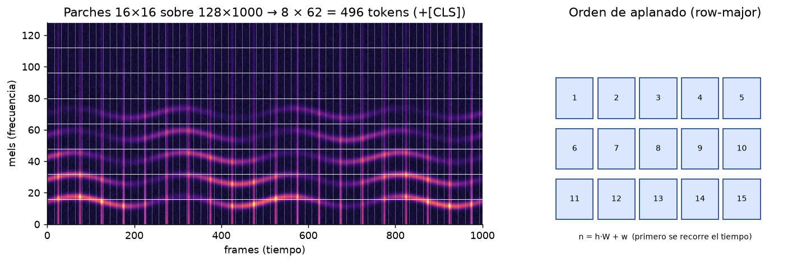

Sea $X \in \mathbb{R}^{F \times T}$ el espectrograma ($F=128$, $T\approx1000$) y parches de $P_f \times P_t = 16 \times 16$. Número de parches:

$$
N = \left\lfloor \tfrac{F}{P_f} \right\rfloor \left\lfloor \tfrac{T}{P_t} \right\rfloor = 8 \times 62 = 496
$$

Cada parche se aplana a $\mathbf p_n \in \mathbb{R}^{P_f P_t} = \mathbb{R}^{256}$ y se proyecta linealmente:

$$
\mathbf z_n = E\,\mathbf p_n + \mathbf b, \qquad E \in \mathbb{R}^{D \times 256}
$$

**Equivalencia con una convolución:** esa proyección aplicada a todos los parches no solapados es exactamente `Conv2d(1, D, kernel=16, stride=16)`: los $D$ filtros son las filas de $E$. Es lo que hace `PatchEmbed` (más eficiente que extraer parches manualmente). Los frames sobrantes ($1001 - 62\cdot16 = 9$) se descartan.

**Intuición:** un parche 16×16 cubre 16 bandas mel × 160 ms. Cada token es "qué hay en esta región de frecuencia y tiempo".

> El AST original (Gong et al., 2021) usa parches *solapados* (stride 10 con kernel 16) para más resolución a coste de más tokens, e inicializa desde ViT/DeiT preentrenado. Este proyecto usa no solapados por simplicidad y memoria.

---

## 3. Codificación posicional y token [CLS]

La auto-atención es **equivariante a permutaciones**: si barajas los tokens, la salida se baraja igual. Sin información de posición, el modelo vería un "saco de parches" sin saber qué es graves/agudos ni antes/después. Se suma un vector de posición $\mathbf e_n \in \mathbb{R}^D$ a cada token:

$$
\mathbf x_n^{(0)} = \mathbf z_n + \mathbf e_n
$$

### 3.1 Aprendida (por defecto)

$E_{pos} \in \mathbb{R}^{(N+1)\times D}$ es un parámetro, inicializado con $\mathcal N(0, 0.02^2)$ truncada. Simple y eficaz, pero **fija la longitud de entrada** (497 tokens; por eso el modelo exige `spec_size`).

### 3.2 Sinusoidal (Vaswani et al., 2017)

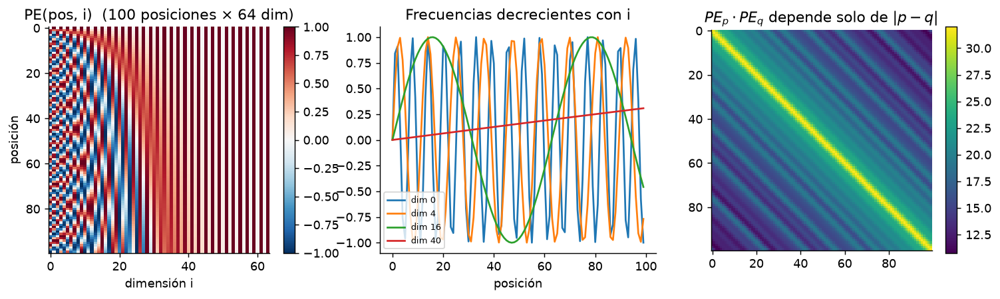

$$
PE(p, 2i) = \sin\!\left(\frac{p}{10000^{2i/D}}\right), \qquad PE(p, 2i+1) = \cos\!\left(\frac{p}{10000^{2i/D}}\right)
$$

Propiedad clave: con $\omega_i = 10000^{-2i/D}$, el par $(\sin\omega_i (p+k), \cos\omega_i (p+k))$ es una **rotación** del par en $p$:

$$
\begin{pmatrix}\sin\omega(p+k)\\ \cos\omega(p+k)\end{pmatrix} =
\begin{pmatrix}\cos\omega k & \sin\omega k\\ -\sin\omega k & \cos\omega k\end{pmatrix}
\begin{pmatrix}\sin\omega p\\ \cos\omega p\end{pmatrix}
$$

Por tanto $PE_{p+k}$ es una función lineal de $PE_p$ (el modelo puede aprender atención "relativa") y $PE_p\cdot PE_q$ depende solo de $|p-q|$ (tercera gráfica).

> **Nota de diseño:** aquí la posición es 1-D (índice aplanado $n = h\cdot W + w$), así que la estructura 2-D (vecino de arriba vs. vecino de la derecha) debe aprenderla el modelo. Alternativas: embeddings separados para frecuencia y tiempo, o RoPE 2-D.

### 3.3 Token [CLS]

Se antepone un vector aprendible $\mathbf c \in \mathbb{R}^D$. Como todos los tokens pueden atenderlo y él puede atender a todos, tras $L$ capas actúa como **resumen global** del clip; es el que entra a la cabeza de clasificación. Alternativa implementada (`cls_token: false`): promedio de todos los tokens.

---

## 4. Auto-atención: el núcleo matemático

Sea $X \in \mathbb{R}^{n \times D}$ la secuencia (filas = tokens). Se calculan tres proyecciones:

$$
Q = X W_Q,\qquad K = X W_K,\qquad V = X W_V, \qquad W_Q, W_K \in \mathbb{R}^{D\times d_k},\; W_V \in \mathbb{R}^{D \times d_v}
$$

**Atención de producto escalar escalado:**

$$
\boxed{\;\mathrm{Attention}(Q,K,V) = \mathrm{softmax}\!\left(\frac{Q K^\top}{\sqrt{d_k}}\right) V\;}
$$

Desglose:

1. $S = QK^\top/\sqrt{d_k} \in \mathbb{R}^{n\times n}$: $S_{ij}$ = afinidad de la consulta $i$ con la clave $j$.
2. $A = \mathrm{softmax}_{\text{fila}}(S)$, es decir $A_{ij} = \dfrac{e^{S_{ij}}}{\sum_{j'} e^{S_{ij'}}}$. Cada fila es una distribución de probabilidad.
3. $O = AV$: cada salida es una **media ponderada de los valores**: $\mathbf o_i = \sum_j A_{ij}\mathbf v_j$.

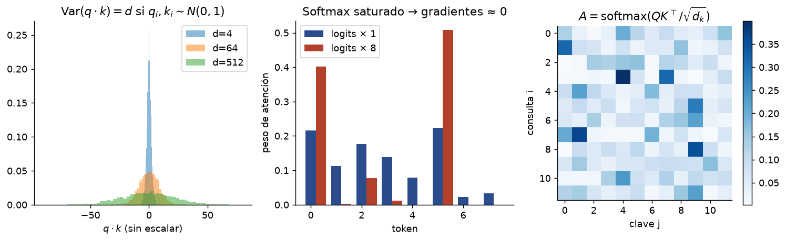

### 4.1 Por qué se divide entre $\sqrt{d_k}$

Si $q_l, k_l$ son independientes con media 0 y varianza 1, entonces $q\cdot k = \sum_{l=1}^{d_k} q_l k_l$ tiene $\mathbb E = 0$ y $\mathrm{Var} = d_k$ (primera gráfica). Los logits crecen como $\sqrt{d_k}$, el softmax se **satura** (casi one-hot, segunda gráfica) y su gradiente se anula. Dividir por $\sqrt{d_k}$ devuelve varianza 1.

### 4.2 Interpretación

- $W_Q$: "¿qué busco?", $W_K$: "¿qué ofrezco?", $W_V$: "¿qué contenido aporto?".
- Es una **búsqueda blanda en una tabla clave→valor**: si $A$ fuera one-hot sería un *lookup*.
- En el AST, un parche de graves puede atender a parches de otros instantes con el mismo patrón rítmico, o a armónicos superiores del mismo instante.
- La matriz $A \in \mathbb{R}^{497\times497}$ por cabeza es lo que se visualiza en *attention maps* (ver ejercicio 15.4).

### 4.3 Propiedades

- **Alcance global en una capa:** toda pareja de tokens interactúa directamente (camino de longitud 1), a diferencia de CNN (campo receptivo local que crece con la profundidad) o RNN (camino de longitud $O(n)$).
- **Sin sesgo inductivo espacial:** no hay localidad ni invariancia a traslación incorporada. Por eso los Transformers necesitan más datos (o preentrenamiento) que las CNN. Es la causa principal de la brecha entre `ast_scratch` y `ast_pretrained` en este proyecto.
- **Coste** $O(n^2 D)$ en tiempo y $O(n^2)$ en memoria por cabeza (la matriz $A$); `F.scaled_dot_product_attention` usa FlashAttention para no materializarla.

---

## 5. Multi-head attention

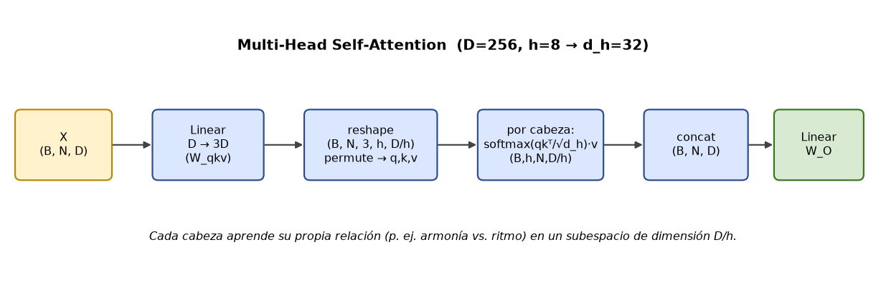

Con $h$ cabezas y $d_k = d_v = D/h$ ($256/8 = 32$):

$$
\mathrm{head}_a = \mathrm{Attention}(XW_Q^{(a)}, XW_K^{(a)}, XW_V^{(a)}),\qquad
\mathrm{MHSA}(X) = \mathrm{Concat}(\mathrm{head}_1,\dots,\mathrm{head}_h)\,W_O
$$

con $W_O \in \mathbb{R}^{D\times D}$. Cada cabeza trabaja en un subespacio de dimensión $D/h$ y puede especializarse en un tipo de relación (armonía, ritmo, textura…). El coste total es el mismo que una sola cabeza de dimensión $D$.

**Implementación eficiente** (`_attn` en `models/ast_scratch.py`): las $3h$ proyecciones se hacen con una sola `Linear(D, 3D)`, se hace `reshape(B, N, 3, h, D/h)` y `permute` para obtener $q,k,v$ de forma $(B,h,N,D/h)$; tras la atención, `transpose(1,2).reshape(B,N,D)` concatena las cabezas.

---

## 6. El bloque encoder: LayerNorm, MLP, residuales

### 6.1 Pre-LN

$$
\begin{aligned}
\mathbf x' &= \mathbf x + \mathrm{DropPath}\big(\mathrm{MHSA}(\mathrm{LN}(\mathbf x))\big)\\
\mathbf x'' &= \mathbf x' + \mathrm{DropPath}\big(\mathrm{MLP}(\mathrm{LN}(\mathbf x'))\big)
\end{aligned}
$$

El Transformer original usa *post-LN* ($\mathrm{LN}(x + F(x))$). *Pre-LN* (usado aquí, como ViT/AST) entrena de forma mucho más estable y apenas necesita warm-up (Xiong et al., 2020), porque el camino residual queda como una "autopista" sin normalizaciones intermedias.

### 6.2 LayerNorm

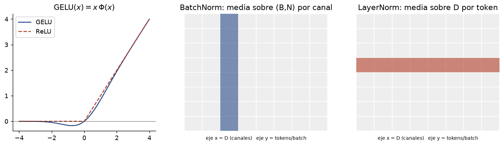

Para cada token $\mathbf x \in \mathbb{R}^D$ de forma independiente:

$$
\mathrm{LN}(\mathbf x) = \boldsymbol\gamma \odot \frac{\mathbf x - \mu}{\sqrt{\sigma^2 + \epsilon}} + \boldsymbol\beta,\qquad
\mu = \frac1D\sum_i x_i,\;\; \sigma^2 = \frac1D\sum_i (x_i-\mu)^2
$$

Normaliza sobre las características (no sobre el batch como BatchNorm), así no depende del tamaño de batch ni difiere entre train/eval, y funciona con secuencias de longitud variable.

### 6.3 MLP (red *feed-forward* por token)

$$
\mathrm{MLP}(\mathbf x) = W_2\,\mathrm{GELU}(W_1 \mathbf x + \mathbf b_1) + \mathbf b_2,\quad W_1 \in \mathbb{R}^{4D\times D},\; W_2\in\mathbb{R}^{D\times 4D}
$$

Se aplica **igual a cada token por separado**: la atención mezcla información *entre* tokens; el MLP la procesa *dentro* de cada token (y concentra ~2/3 de los parámetros). GELU: $\mathrm{GELU}(x) = x\,\Phi(x)$, con $\Phi$ la CDF normal; es una ReLU suave y no monótona cerca de 0.

### 6.4 Conexiones residuales

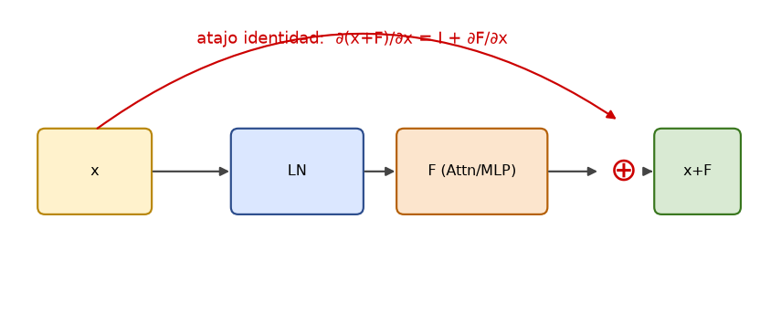

$\mathbf y = \mathbf x + F(\mathbf x)$ implica $\partial \mathbf y/\partial \mathbf x = I + \partial F/\partial \mathbf x$: el gradiente tiene siempre un camino directo de salida a entrada (como en ResNet), lo que permite apilar 12+ bloques sin que se desvanezca. Una red de $L$ bloques se puede ver como un *conjunto* de $2^L$ caminos de distinta longitud.

### 6.5 DropPath (profundidad estocástica)

Durante el entrenamiento, con probabilidad $p_\ell$ se anula la rama residual completa de una muestra: $\mathbf x + \frac{m}{1-p_\ell}F(\mathbf x)$, $m\sim\mathrm{Bernoulli}(1-p_\ell)$. La tasa crece linealmente con la profundidad hasta `drop_path_rate` (0.1). Equivale a entrenar un conjunto de redes de profundidad variable.

---

## 7. Cabeza de clasificación y función de pérdida

Tras los $L$ bloques se aplica una LayerNorm final y se toma el token [CLS] $\mathbf h\in\mathbb{R}^D$:

$$
\mathbf z = W_c\,\mathbf h + \mathbf b_c \in \mathbb{R}^K, \qquad p_k = \frac{e^{z_k}}{\sum_j e^{z_j}}, \quad K = 8
$$

**Entropía cruzada** con etiqueta $y$:

$$
\mathcal L_{CE} = -\log p_y = -z_y + \log\sum_j e^{z_j}
$$

(se calcula con *log-sum-exp* estable; `F.cross_entropy` recibe logits, **no** probabilidades). Minimizarla equivale a maximizar la verosimilitud de la etiqueta (o a minimizar $\mathrm{KL}(\text{one-hot}\,\|\,p)$).

**Gradiente respecto a los logits** (resultado fundamental):

$$
\frac{\partial \mathcal L_{CE}}{\partial z_k} = p_k - \mathbb 1[k = y]
$$

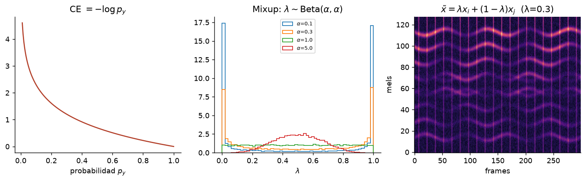

**Con Mixup** (`training/trainer.py`, `data/transforms.py::mixup_batch`): $\tilde x = \lambda x_i + (1-\lambda)x_j$, $\lambda \sim \mathrm{Beta}(\alpha,\alpha)$ y

$$
\mathcal L = \lambda\,\mathcal L_{CE}(\mathbf z, y_i) + (1-\lambda)\,\mathcal L_{CE}(\mathbf z, y_j)
$$

**Línea base de cordura:** con pesos aleatorios, $p_k\approx 1/K$ y $\mathcal L \approx \ln 8 = 2.079$. Si tu primera pérdida es muy distinta, hay un bug (§14).

---

## 8. Retropropagación a través del Transformer

Esta sección es lo que implementa `docs/transformer_numpy.py` (verificado numéricamente). Notación: $\bar{(\cdot)} = \partial\mathcal L/\partial(\cdot)$.

### 8.1 Capa lineal $Y = XW + \mathbf b$

$$
\bar X = \bar Y W^\top,\qquad \bar W = X^\top \bar Y,\qquad \bar{\mathbf b} = \textstyle\sum_{\text{filas}} \bar Y
$$

### 8.2 Softmax por filas $\mathbf a = \mathrm{softmax}(\mathbf s)$

El jacobiano es $\partial a_i/\partial s_j = a_i(\delta_{ij} - a_j)$, es decir $J = \mathrm{diag}(\mathbf a) - \mathbf a\mathbf a^\top$. Por tanto

$$
\bar{\mathbf s} = \mathbf a \odot \big(\bar{\mathbf a} - \langle \bar{\mathbf a}, \mathbf a\rangle \mathbf 1\big)
$$

(sin construir el jacobiano $n\times n$).

### 8.3 Atención $O = AV$, $A=\mathrm{softmax}(QK^\top/\sqrt{d_k})$

$$
\begin{aligned}
\bar V &= A^\top \bar O\\
\bar A &= \bar O\, V^\top\\
\bar S &= A \odot\big(\bar A - \mathrm{rowsum}(\bar A\odot A)\big)\quad\text{(8.2 por filas)}\\
\bar Q &= \bar S\,K/\sqrt{d_k}\\
\bar K &= \bar S^\top Q/\sqrt{d_k}
\end{aligned}
$$

y a continuación 8.1 para $W_Q, W_K, W_V$ y $\bar X = \bar Q W_Q^\top + \bar K W_K^\top + \bar V W_V^\top$.

### 8.4 LayerNorm

Con $\hat{\mathbf x} = (\mathbf x-\mu)/\sigma$ y $\bar{\hat{\mathbf x}} = \bar{\mathbf y}\odot\boldsymbol\gamma$:

$$
\bar{\mathbf x} = \frac{1}{\sigma}\Big(\bar{\hat{\mathbf x}} - \overline{\bar{\hat{\mathbf x}}} - \hat{\mathbf x}\,\overline{\bar{\hat{\mathbf x}}\odot\hat{\mathbf x}}\Big),\qquad
\bar{\boldsymbol\gamma} = \sum \bar{\mathbf y}\odot\hat{\mathbf x},\quad \bar{\boldsymbol\beta} = \sum\bar{\mathbf y}
$$

(la barra superior horizontal = media sobre las $D$ componentes). Esta fórmula impone que $\bar{\mathbf x}$ sea ortogonal a $\mathbf 1$ y a $\hat{\mathbf x}$.

### 8.5 Residual

$\mathbf y = \mathbf x + F(\mathbf x)\Rightarrow \bar{\mathbf x} = \bar{\mathbf y} + J_F^\top\bar{\mathbf y}$. En el código: `return dx + dx1`.

### 8.6 Patch embedding y embeddings

$\bar E = \sum_n \bar{\mathbf z}_n \mathbf p_n^\top$ (suma sobre todos los parches de todo el batch); $\bar E_{pos} = \sum_{\text{batch}}\bar{\mathbf x}^{(0)}$; $\bar{\mathbf c} = \sum_{\text{batch}} \bar{\mathbf x}^{(0)}_{\text{CLS}}$.

> **Ejercicio recomendado:** ejecutar `python docs/transformer_numpy.py` y romper a propósito una fórmula (p. ej. quitar `/np.sqrt(dh)` solo en `mhsa_bwd`) para ver cómo falla la comprobación.

---

## 9. Optimización: AdamW, warm-up, coseno

### 9.1 AdamW (Loshchilov & Hutter, 2019)

Con gradiente $g_t$, momentos $m_t = \beta_1 m_{t-1}+(1-\beta_1)g_t$, $v_t = \beta_2 v_{t-1}+(1-\beta_2)g_t^2$ y corrección de sesgo $\hat m_t = m_t/(1-\beta_1^t)$, $\hat v_t = v_t/(1-\beta_2^t)$:

$$
\theta_{t+1} = \theta_t - \eta_t\left(\frac{\hat m_t}{\sqrt{\hat v_t}+\epsilon} + \lambda\,\theta_t\right)
$$

El **decaimiento de pesos desacoplado** ($\lambda\theta_t$ fuera del término adaptativo) es lo que distingue AdamW de Adam + L2. Valores del proyecto: $\eta=10^{-4}$, $\beta=(0.9, 0.999)$, $\lambda=0.05$.

### 9.2 Recorte de gradiente

$\mathbf g \leftarrow \mathbf g\cdot\min\!\big(1,\ c/\lVert\mathbf g\rVert_2\big)$, con $c = 1$. Evita saltos por batches atípicos.

### 9.3 Warm-up + decaimiento coseno

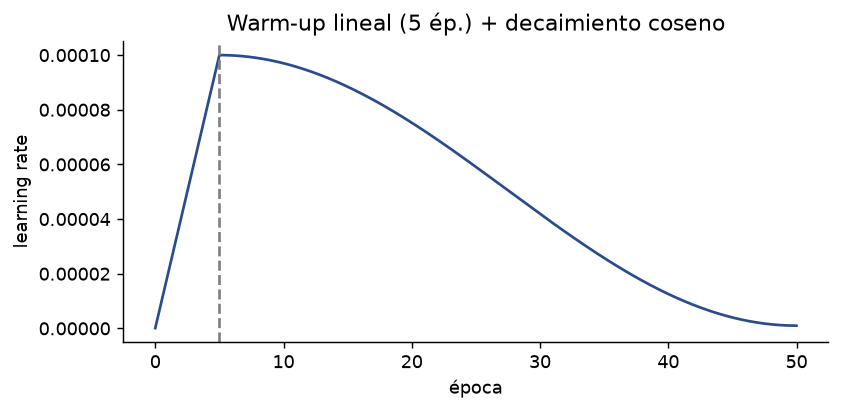

$$
\eta_t = \begin{cases}\eta_{\max}\,\dfrac{t}{T_w} & t<T_w\\[2mm] \eta_{\min} + \tfrac12(\eta_{\max}-\eta_{\min})\left(1+\cos\dfrac{\pi (t-T_w)}{T-T_w}\right) & t\ge T_w\end{cases}
$$

El warm-up es necesario porque al inicio $\hat v_t$ es una estimación ruidosa y la atención es muy sensible; ver `training/scheduler.py` (se llama por *paso*, no por época).

### 9.4 Precisión mixta

Se usa `bfloat16` en forward/backward (mismo rango exponente que fp32, sin necesidad de *loss scaling*) con parámetros maestros en fp32.

---

## 10. Regularización y aumento de datos

Los Transformers sin preentrenar sobreajustan fácilmente con datasets pequeños (FMA-small: 8000 clips). Capas de defensa usadas aquí:

| Técnica | Qué hace | Dónde |
|---|---|---|
| **Recorte aleatorio de 10 s** de 30 s | Aumenta variedad temporal | `data/dataset.py` |
| **SpecAugment** | Enmascara bandas de frecuencia y tiempo | `data/transforms.py` |
| **Mixup** ($\alpha=0.3$) | Interpola entradas y etiquetas | `data/transforms.py` |
| **Dropout** (0.1) | Anula activaciones | MLP, proyección |
| **DropPath** (0.1) | Anula ramas residuales | bloque |
| **Weight decay** (0.05) | Penaliza pesos grandes | AdamW |
| **Early stopping** | Para al dejar de mejorar val_acc | `training/early_stopping.py` |

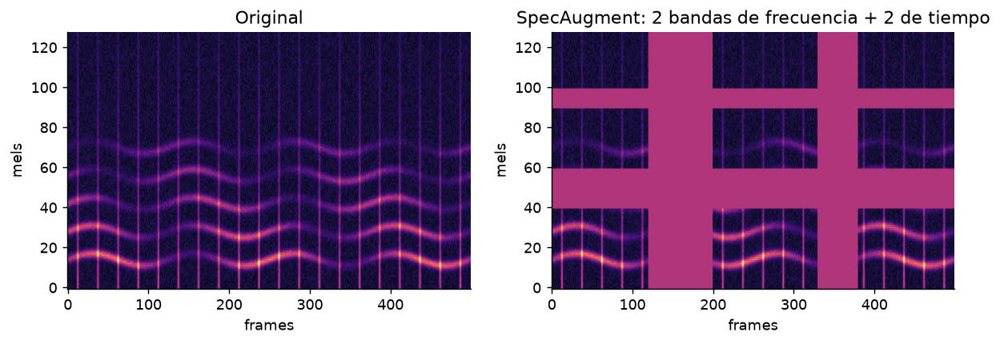

SpecAugment (Park et al., 2019): máscara de $f\in[0,F]$ bandas mel consecutivas y $t\in[0,T]$ frames, puestos a 0 (= la media tras normalizar). Obliga al modelo a no depender de una sola banda o instante.

**Evaluación sin aumentos:** ventanas deslizantes de 10 s con salto de 5 s; las probabilidades de las ventanas se promedian por clip (`evaluation/`).

---

## 11. Complejidad, parámetros y memoria

### 11.1 Parámetros del modelo `ast_scratch` ($D=256$, $L=12$)

| Componente | Fórmula | Parámetros |
|---|---|---|
| Atención / bloque | $4D^2+4D$ | 263 168 |
| MLP / bloque | $8D^2+5D$ | 525 568 |
| 2 LayerNorm / bloque | $4D$ | 1 024 |
| **Bloque** | $12D^2+13D$ | **789 760** |
| 12 bloques | | 9 477 120 |
| Patch embed | $256\cdot D + D$ | 65 792 |
| Pos. embedding | $497\cdot D$ | 127 232 |
| [CLS] + LN final | $D + 2D$ | 768 |
| Cabeza | $D\cdot 8+8$ | 2 056 |
| **Total** | | **≈ 9.67 M** |

(Compara: AST original con ViT-Base = 86 M; de ahí que preentrenado rinda más pero sea 9× mayor.)

### 11.2 Coste computacional (por muestra, un bloque)

$$
\text{FLOPs} \approx \underbrace{2\cdot 4 n D^2}_{\text{proy. QKV, O}} + \underbrace{2\cdot 2 n^2 D}_{QK^\top,\ AV} + \underbrace{2\cdot 8 n D^2}_{\text{MLP}} = 24\,nD^2 + 4\,n^2 D
$$

Con $n=497$, $D=256$: $24nD^2 \approx 0.78$ GFLOP y $4n^2D \approx 0.25$ GFLOP. La atención cuadrática pesa ~25 % aquí; domina cuando $n > 6D$. Duplicar la duración del clip (10 s→20 s) **cuadruplica** el coste de atención.

### 11.3 Memoria

Activaciones $\propto B\cdot L\cdot n\cdot D$ y, sin FlashAttention, $B\cdot L\cdot h\cdot n^2$ (para $B=64$, $h=8$, $L=12$, $n=497$ en 16 bits: ≈ 3 GB solo para las matrices $A$, más lo que guarde el softmax/dropout). FlashAttention (`F.scaled_dot_product_attention`) evita esa matriz. Si falta VRAM: reducir `batch_size`, usar `accumulate_grad_batches` o `gradient_checkpointing`.

---

## 12. Guía de construcción desde cero (paso a paso)

Regla de oro: **construye en capas pequeñas y comprueba cada una antes de pasar a la siguiente.** Cada paso tiene un *test de aceptación*. El código completo vive en el repo; aquí está la progresión.

### Paso 0 — Entorno

```bash
python -m venv .venv && .venv\Scripts\activate         # Windows
pip install torch torchaudio --index-url https://download.pytorch.org/whl/cu128   # ver README para tu GPU
pip install -r requirements.txt
pytest -q
```

### Paso 1 — Verificar la matemática en numpy (sin PyTorch)

Ejecuta `python docs/transformer_numpy.py`. Debe imprimir `OK`. Antes de usar autograd, entiende y reproduce a mano las derivadas de la §8.

### Paso 2 — Datos: audio → log-mel (`data/`)

1. Descargar FMA (`data/download.py`) y filtrar a los 8 géneros del `configs/dataset/*.yaml`.
2. Calcular y cachear log-mel en `.npy` (`data/preprocess.py`): evita decodificar MP3 en cada época.
3. Calcular media/std **solo con el split de entrenamiento** (`data/stats.py`) para evitar fuga de datos.
4. `Dataset` con recorte aleatorio (train) o ventanas fijas (eval).

*Aceptación:* `tests/test_dataset.py`; visualiza un espectrograma (debe verse como la figura 01) y comprueba `shape == (1, 128, ~1000)`.

### Paso 3 — Patch embedding

```python
class PatchEmbed(nn.Module):
    def __init__(self, patch_size, in_channels, embed_dim):
        super().__init__()
        self.proj = nn.Conv2d(in_channels, embed_dim, kernel_size=patch_size, stride=patch_size)
    def forward(self, x):                      # (B, 1, F, T)
        x = self.proj(x)                       # (B, D, F/16, T/16)
        return x.flatten(2).transpose(1, 2)    # (B, N, D)
```

*Aceptación:* para entrada $(2,1,128,1000)$ la salida es $(2,496,D)$. Comprueba además que equivale a aplanar un parche y multiplicar por `proj.weight.view(D,-1).T`.

### Paso 4 — Atención (primero a mano)

```python
def attention(q, k, v):                          # (B, h, N, dh)
    s = q @ k.transpose(-2, -1) / q.shape[-1] ** 0.5
    return s.softmax(-1) @ v
```

*Aceptación:* `torch.allclose(attention(q,k,v), F.scaled_dot_product_attention(q,k,v), atol=1e-5)`. Después sustituye por `F.scaled_dot_product_attention` (misma salida, mucho más rápido y con menos memoria).

### Paso 5 — Multi-head + bloque

Implementa `MHSA` (una `Linear(D,3D)`, reshape/permute, atención, `Linear(D,D)`) y `TransformerEncoderBlock` con pre-LN y residuales exactamente como la §6 (ver `models/ast_scratch.py`).

*Aceptaciones:*
- `y.shape == x.shape`.
- **Equivariancia a permutaciones:** sin posiciones, `block(x[:, perm]) ≈ block(x)[:, perm]`. (Si falla, hay mezcla indebida entre tokens.)
- **Sin fuga entre muestras:** cambiar la muestra 0 del batch no altera la salida de la muestra 1.
- Mismos resultados que `nn.MultiheadAttention` copiando pesos (opcional, buen ejercicio).

### Paso 6 — Modelo completo

Ensambla: `PatchEmbed` → concatenar [CLS] → sumar `pos_embed` → `Dropout` → $L$ bloques → `LayerNorm` → [CLS] → `Linear(D, K)`.

Detalles que causan bugs:
- Inicializar `Linear` con `trunc_normal_(std=0.02)`, bias a 0, LayerNorm $\gamma=1,\beta=0$; [CLS] y `pos_embed` con `trunc_normal_(0.02)`.
- `num_patches = (F // pf) * (T // pt)`; si cambias la duración del clip, el `pos_embed` debe cambiar de tamaño (o interpolarse).
- El número de tokens = parches + 1.

*Aceptación* (`tests/test_model_shapes.py`): logits $(B,8)$; pérdida inicial ≈ $\ln 8\approx2.08$; nº de parámetros ≈ 9.67 M (tabla §11.1).

### Paso 7 — Comprobación de gradientes y sobreajuste de un batch

Antes de entrenar de verdad:

```python
x, y = next(iter(train_loader))
for step in range(200):                    # un solo batch fijo
    loss = F.cross_entropy(model(x), y); opt.zero_grad(); loss.backward(); opt.step()
# la pérdida debe ir a ~0 y la accuracy a 100 %
```

Si no puede memorizar 64 muestras, hay un bug en el modelo/datos/etiquetas, no un problema de hiperparámetros (`tests/test_overfit.py`).

### Paso 8 — Bucle de entrenamiento (`training/`)

Orden por iteración: aumentos (SpecAugment, Mixup) → `autocast(bf16)` → forward → pérdida (mezclada si Mixup) → `backward` → recorte de gradiente → `optimizer.step()` → `scheduler.step()` (por paso) → `zero_grad`. Añade: validación por época, *checkpoint* del mejor `val_acc`, *early stopping*, TensorBoard.

### Paso 9 — Evaluación e inferencia

Ventanas de 10 s con salto de 5 s → softmax por ventana → promedio por clip → *accuracy*, F1 macro, matriz de confusión (`evaluation/`, `scripts/evaluate.py`, `scripts/predict.py`, demo `scripts/app.py`).

### Paso 10 — Experimentos recomendados (ablaciones)

| Experimento | Hipótesis a contrastar |
|---|---|
| `pos_embed: learned` vs `sinusoidal` (y, si lo añades, ninguno) | La posición importa |
| `cls_token` vs *mean pooling* | Equivalentes en rendimiento |
| profundidad 4/8/12 y $D$ 128/256/384 | Capacidad vs. sobreajuste |
| con/sin SpecAugment, Mixup | Peso de cada regularizador |
| scratch vs preentrenado (`ast_pretrained`) | Valor del preentrenamiento con pocos datos |
| parches 16×16 vs 8×8 vs solapados | Resolución vs. coste $O(n^2)$ |

Fija la semilla, guarda la configuración con cada resultado y reporta media ± desviación en ≥3 semillas.

---

## 13. Entrenamiento y evaluación

Comandos del proyecto (tomados del `README.md`):

```bash
python scripts/prepare_data.py --dataset configs/dataset/fma_small.yaml
python scripts/train.py --dataset configs/dataset/fma_small.yaml --model configs/model/ast_scratch.yaml
python scripts/evaluate.py --checkpoint checkpoints/<experiment>/best.pt --dataset configs/dataset/fma_small.yaml
```

Métricas:

$$
\mathrm{Acc} = \tfrac1N\sum_i \mathbb 1[\hat y_i=y_i],\qquad
F1_k = \tfrac{2 P_k R_k}{P_k+R_k},\qquad F1_{macro}=\tfrac1K\sum_k F1_k
$$

Usa F1 macro si las clases están desbalanceadas. **Nunca** midas en el conjunto de test para elegir hiperparámetros; usa validación. Cuidado con la **fuga por artista/álbum** (el split oficial de FMA lo evita; un split aleatorio por pista infla resultados).

---

## 14. Diagnóstico de problemas típicos

| Síntoma | Causa probable | Qué hacer |
|---|---|---|
| Pérdida inicial ≫ 2.08 | Pesos mal inicializados, logits con gran varianza | Revisar `_init_weights`, entrada normalizada |
| No baja de ~2.08 | LR demasiado bajo/alto, etiquetas desalineadas, entrada constante | Overfit de 1 batch; imprimir `x.std()` |
| Pérdida → NaN | LR alto, fp16 sin escalado, $\log 0$ | bf16, clip de gradiente, bajar LR |
| Train 95 %, val 40 % | Sobreajuste (datos pequeños) | Más aumentos, preentrenado, modelo menor |
| Train y val bajas | Subajuste / pocos epochs | Más épocas o LR; comprobar warm-up |
| Atención uniforme en todas las capas | Aún sin entrenar, o LR demasiado bajo | Entrenar más; visualizar mapas |
| OOM | $n^2$ y batch grandes | Menor batch, acumulación, checkpointing |
| Val > Train | Aumentos fuertes/dropout activos en train | Normal con Mixup+SpecAugment |
| Resultado no reproducible | Semillas / `num_workers` | Fijar semilla, `torch.backends.cudnn.deterministic` |

---

## 15. Plan de estudio y ejercicios

**Orden sugerido (≈ 4 semanas):**

1. *Semana 1:* álgebra lineal y softmax/entropía cruzada; leer §1–§4; ejecutar `transformer_numpy.py`.
2. *Semana 2:* "The Illustrated Transformer" + paper *Attention Is All You Need*; implementar atención a mano (Paso 4).
3. *Semana 3:* ViT y AST (papers); construir pasos 3–7; reproducir los tests.
4. *Semana 4:* entrenar, ablaciones y análisis de resultados.

**Ejercicios:**

1. Demuestra que $\mathrm{softmax}(\mathbf s + c\mathbf 1) = \mathrm{softmax}(\mathbf s)$ y úsalo para justificar la versión estable (restar el máximo).
2. Demuestra $\partial\mathcal L_{CE}/\partial z_k = p_k - y_k$ partiendo de $\mathcal L = -\log\mathrm{softmax}(\mathbf z)_y$.
3. Calcula los parámetros de un AST con $D=384$, $L=6$, $h=6$ y compáralos con la fórmula $12D^2L$.
4. Extrae y dibuja la atención del token [CLS] sobre la rejilla $8\times62$ de parches para un clip de *Electronic* y otro de *Folk* (*attention rollout*, Abnar & Zuidema, 2020).
5. Demuestra que sin codificación posicional el bloque es equivariante a permutaciones (§Paso 5) y compruébalo numéricamente.
6. Sustituye la posición aprendida 1-D por dos embeddings (frecuencia y tiempo) sumados; ¿mejora?
7. Calcula la pérdida de entropía cruzada esperada de un clasificador uniforme en 8 clases y compárala con la inicial de tu modelo.
8. Implementa *label smoothing* ($\varepsilon=0.1$) y mide su efecto en la calibración (ECE).

---

## 16. Referencias

**Transformer y atención**
- Vaswani, A. et al. (2017). *Attention Is All You Need*. NeurIPS. https://arxiv.org/abs/1706.03762
- Bahdanau, D., Cho, K., Bengio, Y. (2015). *Neural Machine Translation by Jointly Learning to Align and Translate*. https://arxiv.org/abs/1409.0473
- Alammar, J. *The Illustrated Transformer*. https://jalammar.github.io/illustrated-transformer/
- Phuong, M., Hutter, M. (2022). *Formal Algorithms for Transformers*. https://arxiv.org/abs/2207.09238 (pseudocódigo preciso)
- Elhage, N. et al. (2021). *A Mathematical Framework for Transformer Circuits*. https://transformer-circuits.pub/2021/framework/index.html
- Harvard NLP. *The Annotated Transformer*. https://nlp.seas.harvard.edu/annotated-transformer/

**Visión y audio**
- Dosovitskiy, A. et al. (2021). *An Image is Worth 16x16 Words: Transformers for Image Recognition at Scale* (ViT). https://arxiv.org/abs/2010.11929
- Touvron, H. et al. (2021). *Training data-efficient image transformers & distillation through attention* (DeiT). https://arxiv.org/abs/2012.12877
- Gong, Y., Chung, Y.-A., Glass, J. (2021). *AST: Audio Spectrogram Transformer*. Interspeech. https://arxiv.org/abs/2104.01778
- Abnar, S., Zuidema, W. (2020). *Quantifying Attention Flow in Transformers*. https://arxiv.org/abs/2005.00928
- Defferrard, M. et al. (2017). *FMA: A Dataset For Music Analysis*. ISMIR. https://arxiv.org/abs/1612.01840

**Normalización, optimización, regularización**
- Ba, J. L., Kiros, J. R., Hinton, G. E. (2016). *Layer Normalization*. https://arxiv.org/abs/1607.06450
- Xiong, R. et al. (2020). *On Layer Normalization in the Transformer Architecture*. https://arxiv.org/abs/2002.04745
- He, K. et al. (2016). *Deep Residual Learning for Image Recognition*. https://arxiv.org/abs/1512.03385
- Hendrycks, D., Gimpel, K. (2016). *Gaussian Error Linear Units (GELUs)*. https://arxiv.org/abs/1606.08415
- Kingma, D., Ba, J. (2015). *Adam*. https://arxiv.org/abs/1412.6980
- Loshchilov, I., Hutter, F. (2019). *Decoupled Weight Decay Regularization* (AdamW). https://arxiv.org/abs/1711.05101
- Loshchilov, I., Hutter, F. (2017). *SGDR: Stochastic Gradient Descent with Warm Restarts*. https://arxiv.org/abs/1608.03983
- Huang, G. et al. (2016). *Deep Networks with Stochastic Depth*. https://arxiv.org/abs/1603.09382
- Zhang, H. et al. (2018). *mixup: Beyond Empirical Risk Minimization*. https://arxiv.org/abs/1710.09412
- Park, D. S. et al. (2019). *SpecAugment*. https://arxiv.org/abs/1904.08779
- Dao, T. et al. (2022). *FlashAttention*. https://arxiv.org/abs/2205.14135

**Cursos y libros**
- Karpathy, A. *Neural Networks: Zero to Hero* (incluye *Let's build GPT*). https://karpathy.ai/zero-to-hero.html
- Stanford CS231n y CS224n.
- Goodfellow, Bengio, Courville. *Deep Learning* (MIT Press, 2016): caps. 6, 8, 10. https://www.deeplearningbook.org/
- Müller, M. (2015). *Fundamentals of Music Processing*. Springer. (STFT, mel, representaciones musicales)
- PyTorch docs: `F.scaled_dot_product_attention`, `nn.MultiheadAttention`, `torchaudio.transforms.MelSpectrogram`.

> Los enlaces arXiv son los identificadores canónicos de cada artículo; compruébalos antes de citarlos en la memoria del TFG.
